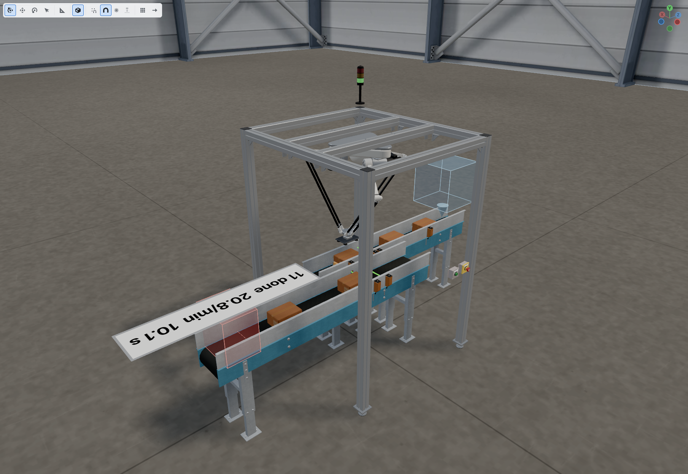
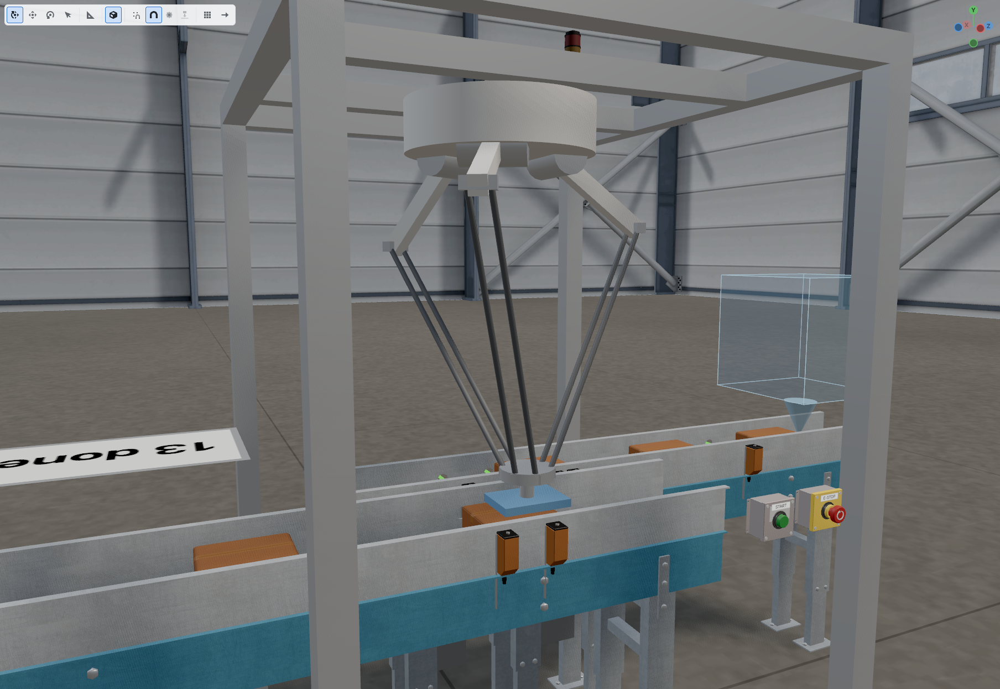
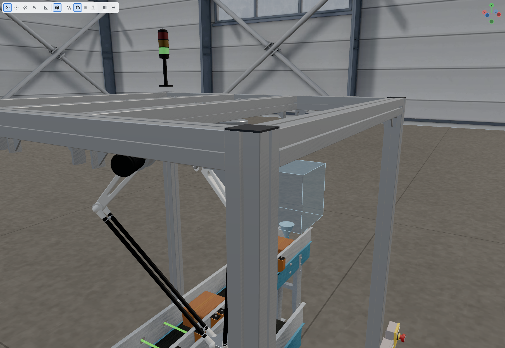

# Delta transfer cell in Open Industry Project

[](https://github.com/sergiudanstan/delta-cell-oip/actions/workflows/ci.yml)
[](https://github.com/sergiudanstan/delta-cell-oip/actions/workflows/codeql.yml)
[](https://scorecard.dev/viewer/?uri=github.com/sergiudanstan/delta-cell-oip)
[](LICENSE)

A three-arm delta robot hanging in a portal frame moves 3 kg cartons one at a time from an infeed belt to the outfeed
belt beside it. The cell is built in [Open Industry Project](https://openindustryproject.org)
(OIP), a free, MIT-licensed browser simulator with Jolt physics and a built-in IEC 61131-3 PLC. The robot is a custom
OIP part, and an ST program drives it through a handshake, the way a real PLC would.



It is the sister of [duopod-cell-oip](https://github.com/sergiudanstan/duopod-cell-oip): the same belts, escapement,
sensors, PLC program and tests, with the 2-axis DuoPod replaced by a delta. The delta part speaks the same handshake,
so the program is unchanged except for its comments.

## Open it

- **Live:** [sergiudanstan.github.io/delta-cell-oip](https://sergiudanstan.github.io/delta-cell-oip/). The OIP editor
  opens with the cell loaded and already running. Stop, E-STOP, START, edit the PLC program or run the project tests
  right there. It is OIP's own editor (pinned commit, MIT) built by `tools/build_site.sh` and served from the
  `gh-pages` branch. It is not the official openindustryproject.org deployment.
- **In the official app:** go to [openindustryproject.org/app](https://openindustryproject.org/app), choose **Import Project**
  and pick [`dist/delta-cell.scene.json`](dist/delta-cell.scene.json). Press Play, then the green START button on the
  operator panel.
- **As a project folder:** this repository *is* the OIP project folder (`project.json`, `scene.json`, `plc/`, `parts/`,
  `tests/`). The OIP desktop app opens it directly.

## What is in the cell

| | |
|---|---|
| Infeed A1 | accumulation belt, 0.4 m/s, 220 mm guides |
| Pick belt A2 | 0.6 m/s; the faster belt opens the gap the escapement blade rises into |
| Escapement | `oip.blade-stop` at the A1/A2 junction (PLC-driven) + a fixed end stop under the robot |
| Outfeed B | 0.4 m/s, ending in a despawner that counts deliveries (`Delivered`) |
| Cartons | 250 × 180 × 120 mm, 3 kg, from a box spawner gated by the PLC (queue full = carton standing at `EyeFull` for 1 s) |
| Photo-eyes | `EyeStop`, `EyeZone`, `EyeGate` (pick lane), `EyeHead` (queue head), `EyeFull`, `EyeB0`/`EyeB1` (drop zone on B) |
| Operator | E-STOP (normally closed, `EStopOk`), START, stack light |
| Robot | `parts/delta.transfer-robot`, our own procedural model of a generic delta in an aluminium-profile portal (Draco GLB, 0.18 MB part) |

### The robot part



The model (`tools/model.mjs`, no vendor model or CAD) has a cast base housing with three drive units (gearbox and
servo motor) under it, tapered cast upper arms with a lightening slot and ball studs on a cross shaft, carbon forearm
pairs with polymer socket cups and two tension springs per pair, a triangular effector with ball studs, and a vacuum
tool with four bellows cups. The portal is 80 × 80 slot profile (T-slots, centre bore, end caps) with cast corner
brackets, foot plates and levelling feet; the robot hangs from two carrier profiles. Every dimension the kinematics use
is read from the behavior, so the model cannot drift from it.



The robot is a rig part. Every tick it turns the TCP into three motor angles (rotary delta, Clavel type, elbow-out
branch) and poses every moving link from the result: the upper arms turn about their motor axes, each forearm is two
parallel rods between the elbow bar and the effector bar, and the effector with the vacuum pad only translates. The
dimensions are sized as an 8 kg-class delta: motor axes on R = 200 mm, upper arms 380 mm, forearms 900 mm, effector
joints on r = 60 mm, arms at 90/210/330°. Moves are minimum-jerk goal-post moves (up, straight across, down), the same
profile as the DuoPod part. A target outside the workspace is refused.

| Tag (default) | Dir | Meaning |
|---|---|---|
| `RobotCmd` | in | point row: 1 ready, 2 pick, 3 place |
| `RobotExecute` | in | rising edge starts the move (hold it until `RobotBusy`) |
| `RobotDone` / `RobotBusy` / `RobotPoint` | out | standing on a point / moving / the row it stands on |
| `Vacuum` / `VacuumOk` | in / out | vacuum command (latched only at standstill) / the gripper really holds a load |
| `RobotEnable` | in | low holds the motion where it is |
| `RobotX`, `RobotZ` | out | actual TCP, mm (across the belts, height above the belt top) |

The point table (x, height, along the belts, mm), travel height and a motion time scale are part parameters.

### The PLC program (`plc/program.st`)

- **Escapement.** The blade drops only when the pick lane is empty (`EyeGate`, `EyeZone` and `EyeStop` all clear) and
  the robot is clear of the infeed column (TCP over belt B or above 250 mm). The released carton accelerates on A2.
  When `EyeHead` sees the gap, A1 stops, the blade rises into the gap, and A1 runs again.
- **Robot cycle.** ready → wait until a carton has settled at the stop → pick → vacuum, wait for `VacuumOk` → wait
  until the drop zone on B is clear → place → release → ready.
- **Supervision.** `ColumnAlarm` latches if the blade is ever open while the TCP is low over the infeed column. It
  stops the line, and START clears it.
- **Safety.** The E-stop drops `Running`, every belt and the feed, and the robot holds where it is. The vacuum stays
  on, so a carried carton is not dropped. **Releasing the E-stop restarts nothing; START does.** The stack light is
  green when running, amber when stopped and red on E-stop.

## Tests

Run from a checkout of OIP (pinned below):

```sh
cd open-industry-project
P=/path/to/delta-cell-oip
npm run check-part -- $P/parts/delta.transfer-robot
npm run validate-project -- $P --strict
npm run check-st -- $P/plc
npm run check-wiring -- $P --strict
npm run check-layout -- $P
npm run test-project -- $P
OIP=$PWD $P/tools/perturb.sh     # the tests must FAIL on mutated programs
node $P/tools/check_kin.mjs        # delta kinematics: loop closure and joint range
```

| Test | What it asserts |
|---|---|
| `transfer` | ≥ 14 cartons delivered in 40 s (counted by the program and by a world probe on belt B), ≥ 17 picked, no carton ever on the floor, never more than one carton in the pick lane |
| `escapement-interlock` | `ColumnAlarm` never fires, the blade really cycles, ≥ 15 picked, one carton at a time in the pick lane |
| `safety` | E-stop mid-transfer (OIP `sensorStuck` fault on the NC contact): the robot holds its TCP to ±0.5 mm and keeps the carton, belts and feed stop, the light turns red; releasing the E-stop keeps everything stopped (amber); START resumes and picking continues |

`tools/check_kin.mjs` solves the kinematics on a grid over the working volume (both belts, ±200 mm along them,
carton top to above the travel height) and at every millisecond of every move of the cycle. Both ends of every rod,
as drawn, must sit on their ball studs (worst error 0 nm in 3980 poses) and the motor angles stay in −17.5…75.2°. It
fails when the ball-stud spacing is off by 1 %.

`tools/perturb.sh` runs the suite on two mutants of the program. With the escapement interlock removed, three tests
fail. With the restart lock removed (`RobotEnable` following the E-stop contact), `safety` fails. The script exits 0
only if both mutants are caught.

**Measured throughput:** the same as the DuoPod cell, since the move profile is the same and the carton path limits
the rate: 14 delivered by 35.3 s in the `transfer` test. A real delta could move faster; raise
the rate by shortening the carton path, not by `timeScale` alone.

These are OIP's own physics (Jolt) and PLC engine. Nothing here is physically validated.

## Rebuilding

| Script | Does |
|---|---|
| `tools/make_part.sh` | `model.mjs` (our procedural GLB) → weld + Draco → `build_part.mjs` (manifest, model embedded, rest poses from the behavior's kinematics) → `check-part` |
| `tools/check_kin.mjs` | the kinematics check above |
| `tools/build_scene.sh` | lay the whole scene out with OIP's `add-part` (every parameter checked), bind `plc/` and `tests/` |
| `tools/scene_file.mjs` | write `dist/delta-cell.scene.json`, the one-file scene for Import Project |
| `tools/build_site.sh` | build the GitHub Pages site (OIP editor + `site/`: base-path shim, auto-load of the cell) |
| `tools/record.mjs` | stills + MP4 of the cell running in the local OIP editor (Playwright) |

The scripts expect the OIP checkout at `~/code/_vendor/open-industry-project`; set `OIP=` to use another location.

**Pinned OIP commit:** [`7ed2b7d`](https://github.com/Open-Industry-Project/Open-Industry-Project/commit/7ed2b7dbf01835365ba3432bbdd84d933a843dde)
(2026-11-19). OIP is an early release and its formats may change.

## Development

CI (`.github/workflows/ci.yml`) runs on every push and pull request, against the pinned OIP commit
[`7ed2b7d`](https://github.com/Open-Industry-Project/Open-Industry-Project/commit/7ed2b7dbf01835365ba3432bbdd84d933a843dde):

1. **OIP project checks and tests**: `check-part`, `validate-project --strict`, `check-st`, `check-wiring --strict`,
   `check-layout`, `tools/check_kin.mjs`, the three project tests, and `tools/perturb.sh` (the tests must fail on mutated programs).
2. **Published site smoke test**: builds the GitHub Pages site with `tools/build_site.sh`, opens it in headless Chrome
   (`tests/site-smoke.mjs`) and fails unless the cell loads, the PLC runs and the robot picks a carton, with no page
   error or failed request.
3. **Security audit**: `pip-audit` on the hash-pinned CI toolchain, `npm audit` on the test tooling, and `zizmor` on
   the workflows. CodeQL and OpenSSF Scorecard run as their own workflows.

To run the site test locally (needs Google Chrome; set `PW_CHANNEL=chromium` for Playwright's Chromium):

```sh
npm ci --ignore-scripts
OIP=/path/to/open-industry-project tools/build_site.sh _build/site
node tests/site-smoke.mjs _build/site
```

See [CONTRIBUTING.md](CONTRIBUTING.md), [SECURITY.md](SECURITY.md) and [CHANGELOG.md](CHANGELOG.md).

## Licences and disclaimer

- `parts/oip.*` are the project's copies of OIP built-in parts, MIT © Automation Standard LLC and Contributors, see
  [`parts/LICENSE-OIP`](parts/LICENSE-OIP).
- The robot and frame are our own procedural models of a generic delta and a generic slot-profile frame. No vendor model or CAD is used here.
- This project is not affiliated with any robot maker or with Open Industry Project.
